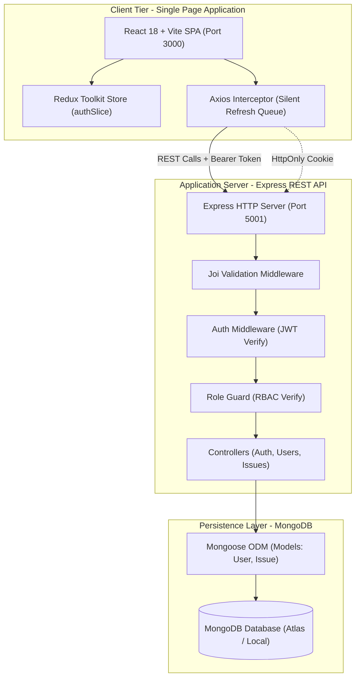
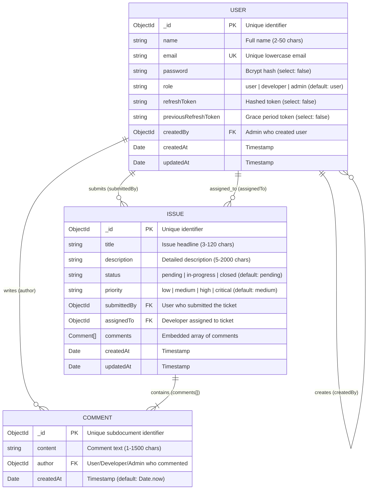

# Business Requirements Document (BRD)

**Project:** IssueTrackr — Issue Tracking & Developer Coordination System  
**Status:** Approved & Implemented  
**Technology Stack:** React 18, Vite, TypeScript, Tailwind CSS v4, Redux Toolkit, Node.js, Express, MongoDB (Mongoose)

---

## 1. Project Purpose & Business Objectives

### 1.1 Purpose
IssueTrackr is a centralized web platform designed to streamline software defect intake, triage, developer task assignment, and issue resolution workflows. It establishes a structured, transparent bridge between end users reporting operational bugs, software developers resolving assigned tickets, and system administrators overseeing project progress and user governance.

### 1.2 Business Objectives
- **Centralized Issue Intake:** Provide a single, authenticated portal where users can report defects, categorize severity with priority flags (`low`, `medium`, `high`, `critical`), and track resolution progress in real time.
- **Controlled Developer Workload:** Restrict developers to their assigned tickets to eliminate triage overhead, improve turnaround times, and provide clear ownership of tickets.
- **Bi-Directional Communication:** Enable developers and administrators to publish technical progress notes and investigation findings directly on tickets, viewable by the ticket submitter.
- **Strict Role-Based Access Control (RBAC):** Enforce zero-trust authorization boundaries so that regular users cannot view or alter other users' tickets, developers can only modify assigned issues, and administrative governance is strictly reserved for authorized admins.
- **Session Security & Continuity:** Maintain secure, stateless API authentication using short-lived JWT access tokens paired with auto-refreshing HttpOnly refresh token cookies to guarantee a frictionless user experience without security vulnerabilities.

---

## 2. User Roles & Access Control

| Role | Target Persona | Scope of Access & Permissions |
| :--- | :--- | :--- |
| **User** (`user`) | End Users, QA, Internal Staff | • Register a personal account and authenticate via email/password. • Submit new defect tickets with title, description, and priority level. • View a personal dashboard of all submitted tickets (`GET /api/issues/my`). • Edit title, description, and priority of pending tickets. • Delete personal tickets. • Read developer and admin progress comments on submitted tickets. |
| **Developer** (`developer`) | Software Engineers | • Access the Developer Portal (`/dev`). • View all issues assigned specifically to their account (`GET /api/issues/assigned`). • Update issue resolution status (`pending` &rarr; `in-progress` &rarr; `closed`). • Post technical progress updates and investigation notes (`POST /api/issues/:id/comments`). • Connect to real-time status change streams (`GET /api/issues/stream`). |
| **Admin** (`admin`) | Engineering Leads, System Admins | • Access the Executive Admin Dashboard (`/admin`). • Monitor global metrics: Total Issues, Pending, In-Progress, Closed, System Health, and Uptime. • View all platform issues with multi-criteria status/priority filters. • Assign and re-assign issues to active developers (`PATCH /api/issues/:id/assign`). • User Management: Create users with specific roles, update roles/passwords, and delete accounts. • Modify or delete any issue ticket across the organization. |

---

## 3. Functional Requirements

### FR-01: Authentication & Session Management
- **Registration (`POST /api/auth/register`):** Validates user name (2-50 chars), unique lowercase email, and password (min 6 chars). Assigns the default `user` role.
- **Login (`POST /api/auth/login`):** Authenticates credentials via bcrypt comparison. Issues a short-lived JWT access token in the JSON response payload and a secure, `HttpOnly` refresh token in an HTTP cookie (7-day lifespan).
- **Silent Token Refresh (`POST /api/auth/refresh-token`):** Exchanges a valid HttpOnly refresh cookie for a fresh access token without user disruption. Implements token rotation and grace-period protection against race conditions.
- **Logout (`POST /api/auth/logout`):** Clears the refresh token from the database, invalidates the cookie, and clears memory state in the client Redux store.
- **Profile Identification (`GET /api/auth/me` & `GET /api/users/profile`):** Returns authenticated user identity, role, and creation metadata.

### FR-02: Issue Intake & Personal Management
- **Ticket Submission (`POST /api/issues`):** Authenticated users submit tickets containing `title` (3-120 chars), `description` (5-2000 chars), and `priority` (`low`, `medium`, `high`, `critical`, default: `medium`).
- **Personal Feed (`GET /api/issues/my`):** Retrieves all issues submitted by the logged-in user, sorted chronologically with populated developer assignments and comments.
- **Ticket Modification (`PUT /api/issues/:id` & `PATCH /api/issues/:id`):** Submitter or system admin can edit title, description, or priority. Non-owners receive `403 Forbidden`.
- **Ticket Deletion (`DELETE /api/issues/:id`):** Submitter or system admin can delete an issue. Unauthorized users receive `403 Forbidden`.

### FR-03: Developer Triage & Assignment
- **Developer Directory (`GET /api/issues/developers`):** Admins fetch active developers for assignment selection dropdowns.
- **Issue Assignment (`PATCH /api/issues/:id/assign`):** Admins assign an issue to a developer ID or unassign (`developerId: null`).
- **Assigned Issue Queue (`GET /api/issues/assigned`):** Developers view only issues assigned to their account, preventing unauthorized access to other development queues.

### FR-04: Issue Status Progression
- **Status Update (`PATCH /api/issues/:id/status`):** Authorized developers (assigned to the ticket) and admins can advance ticket status through the valid lifecycle:
  $$\text{pending} \longrightarrow \text{in-progress} \longrightarrow \text{closed}$$
- **Real-Time Stream (`GET /api/issues/stream`):** Server-Sent Events (SSE) channel broadcasting status changes and assignment events to active developer and admin dashboards.

### FR-05: Technical Comments & Audit Notes
- **Add Comment (`POST /api/issues/:id/comments`):** Assigned developers and admins add technical notes (`content`: 1-1500 chars). Subdocument stores author reference and creation timestamp.
- **Retrieve Comments (`GET /api/issues/:id/comments`):** Viewable by ticket submitter, assigned developer, and admins. Third-party users receive `403 Forbidden`.

### FR-06: Administration & User Governance
- **Executive Dashboard (`GET /api/users/admin`):** Returns aggregate platform metrics (total users, active roles, system operational status, uptime, issue status counts) and recent user/issue lists.
- **Developer Portal Metrics (`GET /api/users/dev`):** Returns developer statistics, sprint overview, active branch, and assigned tickets.
- **User CRUD (`POST /api/users`, `PUT /api/users/:id`, `DELETE /api/users/:id`):** Admins create users with explicit roles (`user`, `developer`), update credentials/roles, and deactivate accounts.

---

## 4. Non-Functional Requirements

- **Security & Authorization:**
  - Passwords hashed using bcrypt with salt factor of 12.
  - Dual-token architecture: Access tokens stored in client memory; refresh tokens stored in `HttpOnly`, `SameSite` cookies.
  - Request payloads validated at the route boundary via strict Joi validation schemas.
  - Role-based middleware (`authorize('admin')`, `authorize('developer', 'admin')`) checks database user state on protected calls.
- **Performance & Scalability:**
  - Database queries optimized with compound and single-field MongoDB indexes on `status`, `submittedBy`, `assignedTo`, and `email`.
  - API response times maintain sub-100ms latency under standard operational loads.
  - Frontend bundle built with Vite, utilizing modern tree-shaking and gzip compression (~108 kB JS bundle).
- **Reliability & Resilience:**
  - Graceful Express server shutdown handling `SIGTERM` and `SIGINT` signals with clean database disconnects.
  - Centralized global error-handling middleware preventing unhandled exceptions and information leaks.
  - Unified JSON response contract (`{ success: boolean, message?: string, data?: any }`).
- **Usability & Design Standards:**
  - Responsive, modern user interface built with Tailwind CSS v4, optimized for desktop and mobile viewports.
  - Accessible form controls with real-time validation feedback, toast alerts, and modal dialogs.
  - Color-coded badges for issue statuses and priority tiers.
- **Maintainability & Code Standards:**
  - 100% TypeScript across backend and frontend, compiling with zero errors under strict compiler checks.
  - Feature-sliced frontend architecture (features: `auth`, `issues`, `developer`, `admin`) with Redux Toolkit state slices.
  - Modular backend MVC architecture separating routes, controllers, models, validators, and middlewares.

---

## 5. System Architecture

### Component Breakdown
1. **Frontend Client:** React 18 SPA bundled via Vite, styled with Tailwind CSS v4. Manages authentication lifecycle, role-based route guards (`ProtectedRoute`), and feature dashboards.
2. **REST API Server:** Express application written in TypeScript. Handles CORS credentials, cookie parsing, Joi schema validation, JWT verification, and controller business logic.
3. **Database Layer:** MongoDB document store connected via Mongoose ODM, utilizing schemas, pre-save hooks, and population queries for relational consistency.

---

## 6. Database Requirements

### Database Specifications & Indexes
- **`User` Collection (`users`):**
  - Unique Index: `email` (1, unique: true).
  - Security projection: `password`, `refreshToken`, and `previousRefreshToken` have `select: false` by default to prevent credential leakage.
- **`Issue` Collection (`issues`):**
  - Single Field Indexes: `status` (1), `submittedBy` (1), `assignedTo` (1).
  - Embedded Subdocuments: `comments` array containing discrete comment subdocuments with auto-generated `_id`.

---

## 7. Deployment & Operations

### 7.1 Production Hosting Architecture
- **Backend API:** **Render** (Node.js Web Service with automatic git-triggered builds).
- **Frontend SPA:** **Vercel** (Global Edge CDN deployment with automatic Vite bundling).
- **Database:** **MongoDB Atlas** (M0 free tier for staging / M10+ dedicated cluster for production).

### 7.2 Production Environment Variables
| Variable | Required In | Description | Example / Recommended Value |
| :--- | :--- | :--- | :--- |
| `PORT` | Backend | Port for Express listener | `5001` (Render configures dynamically) |
| `NODE_ENV` | Backend | Environment mode | `production` |
| `CLIENT_URL` | Backend | Production frontend origin for CORS | `https://your-app-name.vercel.app` |
| `MONGODB_URI` | Backend | MongoDB Atlas connection string | `mongodb+srv://<user>:<pwd>@cluster.mongodb.net/issue_tracker?retryWrites=true&w=majority` |
| `ACCESS_TOKEN_SECRET` | Backend | 256-bit secret for signing access JWTs | Generated 64-char hex string |
| `REFRESH_TOKEN_SECRET`| Backend | 256-bit secret for signing refresh JWTs | Generated 64-char hex string |
| `ACCESS_TOKEN_EXPIRES_IN`| Backend | Access token duration | `15m` |
| `REFRESH_TOKEN_EXPIRES_IN`| Backend | Refresh token duration | `7d` |
| `ADMIN_NAME` | Backend | Initial seeded administrator name | `System Administrator` |
| `ADMIN_EMAIL` | Backend | Initial seeded administrator email | `admin@issuetrackr.com` |
| `ADMIN_PASSWORD` | Backend | Initial administrator password | Complex password (min 8 chars) |
| `VITE_API_URL` | Frontend | Base URL of live Render backend API | `https://your-backend-app.onrender.com/api` |

### 7.3 Step-by-Step Deployment Procedure
1. **Provision Database (MongoDB Atlas):**
   - Deploy a MongoDB Atlas cluster.
   - Configure Network Access (whitelist application server IP addresses or allow `0.0.0.0/0` with strong authentication).
   - Create a database user and copy the connection string (`MONGODB_URI`).
2. **Deploy Backend Service on Render:**
   - Create a new **Web Service** on [Render](https://dashboard.render.com).
   - Root Directory: `backend`.
   - Build Command: `npm install && npm run build`.
   - Start Command: `npm start`.
   - Add all required production environment variables.
   - Run `npm run create-admin` via the Render Shell tab.
   - Copy assigned Render service URL (e.g., `https://issuetrackr-backend.onrender.com`).
3. **Deploy Frontend Application on Vercel:**
   - Import repository to [Vercel](https://vercel.com/dashboard).
   - Root Directory: `frontend`.
   - Framework Preset: `Vite`.
   - Build Command: `npm run build`, Output Directory: `dist`.
   - Add Environment Variable: `VITE_API_URL=https://issuetrackr-backend.onrender.com/api`.
   - Client routing handled by included `frontend/vercel.json` SPA rewrite rule.
   - Deploy and copy assigned Vercel URL (e.g., `https://issuetrackr.vercel.app`).
4. **Cross-Service CORS Sync:**
   - Update `CLIENT_URL` on Render to match your live Vercel URL (`https://issuetrackr.vercel.app`) to authorize credentialed cookies.

### 7.4 Application Update & Maintenance Runbook
1. **Zero-Downtime Backend Deployment:**
   - Pull latest git tag.
   - Run `npm install --omit=dev && npm run build`.
   - Reload process with PM2 cluster: `pm2 reload issuetrackr-backend`.
2. **Frontend Cache-Busting Deployment:**
   - Vite automatically fingerprints asset filenames (`index-[hash].js`).
   - Deploying `dist/` triggers CDN cache invalidation with zero downtime.

### 7.5 Current Deployment Status
- **Frontend Public URL:** `Pending` *(Not yet deployed to a public cloud environment; runs locally at `http://localhost:3000`)*
- **Backend Public API URL:** `Pending` *(Not yet deployed to a public cloud environment; runs locally at `http://localhost:5001/api`)*

---

## 8. Acceptance Criteria & Verification Matrix

| ID | Feature Area | Test Scenario & Verification Criteria | Actual Result |
| :---: | :--- | :--- | :---: |
| **AC-01** | User Authentication | Users register with valid credentials, log in, receive an access token and HttpOnly cookie, and log out with complete token invalidation. | ✅ PASSED |
| **AC-02** | Silent Token Refresh | Expired access tokens trigger background silent refresh using the HttpOnly cookie without user session disruption or forced re-login. | ✅ PASSED |
| **AC-03** | Issue Intake | Authenticated users submit tickets with valid title, description, and priority. Tickets immediately display in user's personal list. | ✅ PASSED |
| **AC-04** | Owner Permissions | Ticket submitters can edit and delete their own tickets. Attempts by non-owners to modify or delete return `403 Forbidden`. | ✅ PASSED |
| **AC-05** | Developer Assignment | Admins assign issues to active developers. Assigned tickets instantly appear in the designated developer's portal queue. | ✅ PASSED |
| **AC-06** | Status Lifecycle | Assigned developers and admins update issue status through `pending` &rarr; `in-progress` &rarr; `closed`. Unassigned developers receive `403 Forbidden`. | ✅ PASSED |
| **AC-07** | Discussion Notes | Developers and admins post technical progress notes on tickets. Submitter can review notes. Unrelated users are denied access (`403`). | ✅ PASSED |
| **AC-08** | Admin Dashboard | Admin overview cards accurately reflect live database totals for total, pending, in-progress, and closed issues. | ✅ PASSED |
| **AC-09** | User Governance | Admins create accounts with explicit roles (`user`, `developer`), update credentials/roles, and delete accounts with immediate access revocation. | ✅ PASSED |
| **AC-10** | Type Integrity | Entire codebase compiles with zero TypeScript errors on backend (`tsc`) and frontend (`tsc && vite build`). | ✅ PASSED |
