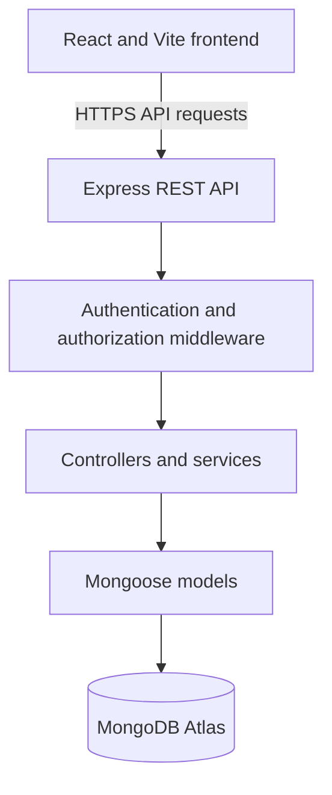

IssueTrackr — Business Requirements Document (BRD)
Project Overview
Project: IssueTrackr — Issue Tracking and Developer Coordination System
Technology stack: React, Vite, TypeScript, Tailwind CSS, Redux Toolkit, Node.js, Express, MongoDB, and Mongoose.
1. Project Purpose and Business Objectives
IssueTrackr provides a central place for users to report issues, administrators to assign them, and developers to track and resolve them.

The main objectives are to:
- Centralize issue reporting and tracking.
- Make issue ownership and status visible to authorized users.
- Support communication through issue comments.
- Give administrators an overview of issue counts and progress.
- Protect user accounts and issue data through authentication and role-based access control.
2. User Roles
Role	Main permissions
User	Register and log in, create issues, view their own issues, and read comments on those issues. Editing or deletion is subject to the application's issue rules.
Developer	View issues assigned to them, update their status, and comment on assigned issues.
Admin	View and manage issues, assign issues to developers, manage user accounts and roles, and view dashboard statistics.

The backend must enforce permissions; hiding frontend controls alone is not sufficient authorization.
3. Functional Requirements
3.1 Authentication and Accounts
- Users can register and log in.
- The application uses access-token authentication and an HttpOnly refresh-token cookie, as implemented in the backend.
- Users can log out and access their authenticated profile.
- Administrators can create, update, and delete user accounts according to the application's role rules.
3.2 Issue Management
- Authenticated users can submit issues with a title, description, and priority.
- Users can view issues they are authorized to access.
- Authorized users can edit or delete issues according to the application's rules.
- Issue priorities are low, medium, high, and critical.
- Issue statuses are pending, in-progress, and closed.
3.3 Assignment and Status Tracking
- Administrators can assign or reassign issues to developers.
- Developers can view their assigned issues and update their status.
- Status changes must be reflected in the relevant issue lists and dashboard counts.
3.4 Comments
- Authorized developers and administrators can add progress comments to issues.
- The issue submitter, assigned developer, and administrators can view comments according to their permissions.
- Users must not be able to view comments on issues they are not authorized to access.
3.5 Dashboards
- The administrator dashboard displays issue totals and counts by status.
- Developers can view their assigned issues and their current statuses.
- Users can view the issues they have submitted.
4. Non-Functional Requirements
- Security: Hash passwords, validate input, protect secrets, and enforce authentication and role-based authorization in the backend.
- Reliability: Return clear error responses and handle database or request failures without exposing sensitive details.
- Usability: Provide a responsive interface suitable for desktop and mobile screens.
- Maintainability: Keep frontend features modular and separate backend routes, controllers, models, middleware, and validation.
- Configuration: Store environment-specific settings in deployment environment variables rather than hardcoding secrets.
5. System Architecture
IssueTrackr uses a frontend/backend architecture:
- Frontend: React and Vite provide the user interface. Redux Toolkit manages shared client state, React Router manages page navigation, and Axios communicates with the API.
- Backend: Node.js and Express expose the REST API. Routes, controllers, middleware, and validation handle requests and permissions.
- Database: MongoDB stores application data, accessed through Mongoose.

Detailed folder structures and endpoint-level documentation belong in the root, frontend, and backend README files.
6. Database Requirements
The database uses the following main data structures. Confirm exact fields and validation rules against the current Mongoose models.
User
Stores a user's name, email, password hash, role, authentication token data where applicable, and timestamps. Email addresses must be unique. Passwords and token secrets must not be returned in normal API responses.
Issue
Stores the issue title, description, status, priority, submitter, assigned developer where applicable, comments, and timestamps.
Comment
Comments are associated with an issue and store the comment content, author reference, and creation time. In the current documented design, comments are embedded within an issue.
7. Deployment and Operations
7.1 Hosting Platforms
- Frontend: Vercel
- Backend API: Render
- Database: MongoDB Atlas
7.2 Live Application URLs
- Frontend: https://issue-tracking-system-ten.vercel.app/
- Backend service: https://issue-tracking-system-7nly.onrender.com/
- Backend API base URL: https://issue-tracking-system-7nly.onrender.com/api
7.3 Required Configuration
Configure the required environment variables in the hosting platforms. The backend configuration includes the MongoDB connection string, production frontend origin for CORS, JWT secrets, runtime settings, and any variables required by the administrator-seeding script. The frontend API base URL must point to the deployed backend API.

Use the exact variable names expected by the current source code and document them in the relevant README files. Never commit real .env files, credentials, or secret values to GitHub; provide a sanitized .env.example template instead.
7.4 Deployment Steps
1. Create or configure a MongoDB Atlas cluster and database user, then set the backend's database connection string.
2. Deploy the backend directory as a Render Web Service. Configure its build and start commands and required environment variables.
3. Deploy the frontend directory as a Vercel project. Configure the frontend API URL and production build settings.
4. Set the backend CORS origin to the deployed frontend URL and verify authentication cookies work across the deployed domains.
5. Run the initial administrator setup using the project's documented seeding process, if required.
6. Test login, issue creation, assignment, status updates, comments, dashboard counts, and the deployed API before sharing the links.
7.5 Updating the Application
Push reviewed changes to the configured GitHub branch. Render and Vercel can deploy the updated services from their connected repository. After each deployment, review build logs and smoke-test the affected features. Update environment variables in the relevant hosting dashboard when configuration changes.
8. Acceptance Criteria
The project is ready for acceptance when the following checks have been verified:
1. Users can register and log in, and authorized sessions can be refreshed and logged out.
2. Users can submit issues and view only issues they are authorized to access.
3. Administrators can view issues, manage users, and assign issues to developers.
4. Assigned developers can update issue statuses and add comments according to their permissions.
5. Authorized users can view comments, while unrelated users are denied access.
6. Dashboard totals and status counts match the issue data returned by the backend.
7. Frontend and backend builds complete successfully, and the deployed application works with the configured database.
8. README documentation explains how to configure, run, test, and deploy the project.